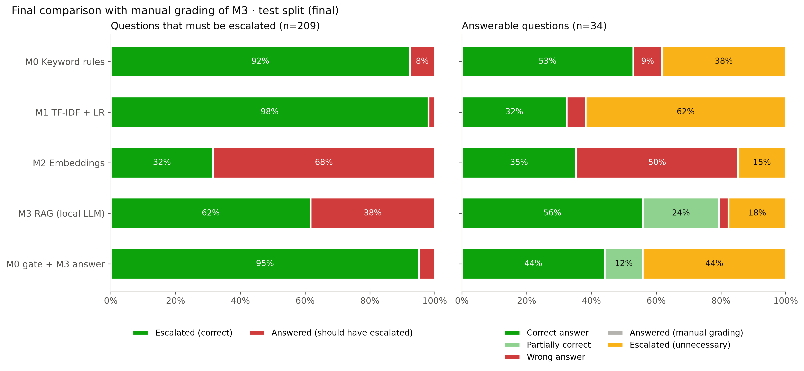

# Chatbot Villa Yaiza RAG

Agente conversacional para Alojamientos Villa Yaiza, una finca de alquiler para eventos en Ibagué (Tolima, Colombia). Responde las consultas frecuentes de los clientes (capacidad, reglas y servicios, ubicación) con información verificada por la administración. Cuando no tiene la respuesta, o cuando la consulta necesita a una persona (precios, fechas disponibles, pagos), escala.

Se comparan cuatro motores de respuesta sobre las mismas preguntas reales de clientes:

| Motor | Técnica |
|---|---|
| M0 | Reglas por palabras clave (equivalente a las respuestas rápidas de WhatsApp Business) |
| M1 | TF-IDF (*Term Frequency–Inverse Document Frequency*) + regresión logística: detecta la intención y devuelve una respuesta plantilla |
| M2 | Embeddings multilingües + búsqueda vectorial con umbral de similitud: devuelve el fragmento más parecido de la base de conocimiento |
| M3 | RAG (*Retrieval-Augmented Generation*): el recuperador de M2 + un modelo de lenguaje local (Ollama) que redacta la respuesta solo con los fragmentos recuperados |

El bot de Telegram usa la combinación **M0 + M3**: M0 decide si escalar y, si no escala, M3 redacta la respuesta.

Proyecto del curso de Sistemas Inteligentes, Universidad de Ibagué (2026).

**Pregunta de investigación:** ¿en qué medida un agente RAG con un modelo de lenguaje local supera a métodos más simples (reglas, clasificación de intención, búsqueda semántica) en precisión, alucinación y abstención correcta sobre consultas reales de la finca?

## Resultados principales

Evaluación sobre el conjunto de prueba (*test*): 243 preguntas reales, anonimizadas, de chats de WhatsApp de la finca. De ellas, 209 (86 %) deben escalar y 34 (14 %) se pueden responder con la base de conocimiento. El *test* se evaluó **una sola vez**, con todos los motores y su configuración congelados antes de la corrida.

| Motor | Abstención correcta | Abstención innecesaria | J | Debía escalar y respondió | Respuestas correctas (respondibles) | Latencia mediana |
|---|---|---|---|---|---|---|
| M0 | 0,92 | 0,38 | **0,54** | 16 de 209 (8 %) | 0,53 | 0,11 ms |
| M1 | 0,98 | 0,62 | 0,36 | 4 de 209 (2 %) | 0,32 | 0,32 ms |
| M2 | 0,32 | 0,15 | 0,17 | 143 de 209 (68 %) | 0,35 | 15 ms |
| M3 | 0,62 | 0,18 | 0,44 | 80 de 209 (38 %) | 0,56 ¹ | 4,3 s |
| **M0 + M3** (bot) ² | 0,95 | 0,44 | 0,51 | **10 de 209 (5 %)** | 0,44 ¹ | — |
| *Siempre escalar* (referencia) | 1,00 | 1,00 | 0,00 | 0 | 0,00 | — |

- **Abstención correcta:** proporción de las consultas que debían escalar que el motor escaló.
- **Abstención innecesaria:** proporción de las consultas respondibles que el motor escaló sin necesidad.
- **J = abstención correcta − abstención innecesaria.** Vale 0 para un motor que siempre escala y 1 para uno perfecto. Se usa porque, con un 86 % de consultas que escalan, el acierto global premia a un motor que nunca responde.
- ¹ M3 redacta texto libre, así que sus respuestas se calificaron a mano (nota 2 = totalmente correcta). En M0, M1 y M2 la corrección es automática y menos exigente.
- ² Combinación simulada a partir de las predicciones guardadas de M0 y M3: la consulta escala si escala cualquiera de los dos. Su latencia no se midió directamente.

Los intervalos de confianza del 95 % (*bootstrap*, 2000 remuestreos, semilla 42) están en [`reports/tables/test/`](reports/tables/test/).



**Conclusiones:**

1. **La tarea central es decidir cuándo escalar.** Ahí el método más simple, M0, obtiene el mejor equilibrio (J = 0,54). No se distingue estadísticamente de M3 ni de M1, pero sí de M2.
2. **La similitud semántica sola no sirve para decidir si escalar.** M2 responde con un fragmento dos de cada tres consultas que debían ir a una persona.
3. **M3 casi no inventa información.** En la calificación manual tuvo 0 alucinaciones en 28 respuestas a preguntas respondibles (68 % totalmente correctas, 96 % al menos parcialmente correctas) y 1 en 68 respuestas en total. Su riesgo es otro: responde, con información real de la base, el 38 % de las consultas que debían escalar.
4. **Combinados, los motores se complementan.** Con M0 como filtro y M3 como redactor, el sistema responde solo el 5 % de lo que debía escalar y ninguna de sus respuestas a preguntas respondibles es incorrecta. En J no supera a M0 solo (0,51 frente a 0,54, diferencia no distinguible).

El análisis completo está en [`reports/resultados_m0_m3.md`](reports/resultados_m0_m3.md).

### Configuración evaluada

Toda la configuración se eligió solo con la partición de entrenamiento (*train*, 563 preguntas).

| Motor | Configuración |
|---|---|
| M0 | Palabras clave en `src/engines/m0_keywords.json`, definidas antes de etiquetar los datos reales |
| M1 | TF-IDF de 1 y 2 gramas + regresión logística, C = 100, umbral de probabilidad 0,15 (validación cruzada de 5 pliegues) |
| M2 | `intfloat/multilingual-e5-small`, un vector por párrafo, umbral de similitud 0,83, top-k = 5 |
| M3 | Recuperador de M2 + `qwen3.6:35b-a3b` en Ollama, temperatura 0, k = 5 fragmentos en el contexto |

## Estructura del repositorio

```
chatbot-Villa-Yaiza-RAG/
├── data/
│   ├── kb/                  # Base de conocimiento: un .md por tema, validado por la administración
│   └── processed/           # Datos anonimizados: messages.csv, labeled.csv, seed.csv, ...
├── notebooks/               # Exploración y generación de tablas y figuras
├── reports/                 # Resultados de evaluación, tablas (.csv y .tex) y figuras (.png y .pdf)
├── src/
│   ├── config.py            # Constantes globales: semilla, rutas, intenciones, modelos
│   ├── data/                # Parser de WhatsApp, anonimizador, verificador de datos personales, etiquetado, partición
│   ├── engines/             # Interfaz común (base.py) y motores M0–M3
│   ├── eval/                # Arnés de evaluación, métricas, selección de modelos y figuras
│   └── bot/                 # Bot de Telegram y demo de consola
├── tests/                   # Pruebas con pytest
├── .env.example             # Plantilla de configuración del bot
└── requirements.txt
```

Todos los motores implementan la misma interfaz (`src/engines/base.py`): `fit(train)` y `respond(mensaje)`, que devuelve la respuesta, la intención, la confianza, si escala, los fragmentos recuperados y la latencia. El arnés de evaluación y el bot solo usan esa interfaz.

### Intenciones

| Intención | ¿Escala? |
|---|---|
| `capacidad` | No |
| `reglas_servicios` (qué incluye, mascotas, música, horarios, cancelaciones…) | No |
| `ubicacion` | No |
| `precio` | Sí |
| `disponibilidad` (fechas) | Sí, siempre |
| `otro_negocio` (temas de la finca que no están en la base: pagos, contratos…) | Sí |
| `fuera_de_alcance` (nada que ver con la finca) | Sí, se abstiene |

## Instalación

Requisitos: Python 3.12 (el código funciona desde 3.11) y, para M3 y el bot, [Ollama](https://ollama.com). Todo se ejecuta en local y con herramientas gratuitas.

En Windows (PowerShell), desde la raíz del repositorio:

```powershell
py -3.12 -m venv .venv
.venv\Scripts\activate
py -m pip install --upgrade pip
pip install -r requirements.txt
```

En Linux o macOS:

```bash
python3.12 -m venv .venv
source .venv/bin/activate
pip install --upgrade pip
pip install -r requirements.txt
```

La primera vez que se usa M2 o M3 se descarga el modelo de embeddings desde Hugging Face.

Solo para M3 y el bot, instala Ollama y descarga el modelo:

```bash
ollama pull qwen3.6:35b-a3b
```

Ollama debe estar abierto mientras se usa M3 (por defecto en `http://localhost:11434`; se cambia con la variable `OLLAMA_HOST`). Es un modelo grande: las latencias de la tabla se midieron en un AMD Ryzen 5 8600HS con una NVIDIA RTX 4050 de 6 GB y 64 GB de RAM.

## Uso

Todos los comandos se ejecutan desde la raíz del repositorio, con el entorno activo. En Windows se puede usar `py` en lugar de `python`.

### Probar un motor en la consola

Simula la conversación sin Telegram:

```bash
python -m src.bot.consola_demo --engine M0
python -m src.bot.consola_demo --engine M1 --train-source real
python -m src.bot.consola_demo --engine M3
```

M1 y M2 se entrenan al arrancar con la partición *train* de `data/processed/labeled.csv`.

### Bot de Telegram

1. Crea un bot con [@BotFather](https://t.me/BotFather) y copia el token.
2. Copia `.env.example` como `.env` y escribe el token en `TELEGRAM_BOT_TOKEN`. El archivo `.env` no se sube a Git.
3. Abre Ollama si el motor usa M3 (el valor por defecto, `BOT_ENGINE=M0+M3`, lo usa).
4. Arranca el bot:

   ```bash
   python -m src.bot.telegram_bot
   ```

5. Para recibir las consultas escaladas, agrega el bot a un grupo de administración, escribe `/miid` en ese grupo y copia el número en `ADMIN_CHAT_ID`. Cuando alguien del equipo responde a un aviso, el bot le reenvía la respuesta al cliente (texto, fotos, ubicaciones, documentos o audios).

El bot funciona con *long polling*: no necesita servidor ni puertos abiertos, pero sí que el equipo esté encendido, con internet y con Ollama abierto. No guarda el texto de las conversaciones: en la terminal solo registra el motor, la intención, si escaló y la latencia. Las demás opciones (`BOT_ENGINE`, `BOT_LLM_TIMEOUT_S`, etc.) están explicadas en `.env.example`.

### Reproducir la evaluación

El arnés solo evalúa sobre *test* con `--allow-test`, para que no se use por accidente mientras se desarrolla. Así se generaron los resultados de `reports/eval_test/`:

```bash
# M0, M1 y M2 (unos segundos)
python -m src.eval.run_eval --eval-input data/processed/labeled.csv --train-source real --engines M0 M1 M2 --split test --allow-test --date 2026-11-17 --output-dir reports/eval_test/clasicos --hardware "AMD Ryzen 5 8600HS, NVIDIA RTX 4050 6 GB, 64 GB RAM"

# M3 (necesita Ollama; unos 20 minutos en el equipo de referencia)
python -m src.eval.run_eval --eval-input data/processed/labeled.csv --train-source real --engines M3 --split test --allow-test --date 2026-11-17 --output-dir reports/eval_test/m3 --hardware "AMD Ryzen 5 8600HS, NVIDIA RTX 4050 6 GB, 64 GB RAM"
```

Para la partición de entrenamiento se usa `--split train` (sin `--allow-test`) y `reports/eval_train/...` como carpeta de salida.

Las tablas y figuras se regeneran con `notebooks/07_resultados_m0_m3_ng.ipynb`, con `SPLIT = "train"` o `SPLIT = "test"`.

Otros scripts de evaluación:

```bash
python -m src.eval.compare_embeddings   # compara los modelos de embeddings (reports/m2_model_selection.csv)
python -m src.eval.benchmark_m3 --n-answerable 10 --n-escalating 5 --k-values 3 5   # compara cuántos fragmentos recibe M3
```

### Pruebas

```bash
python -m pytest
python -m ruff check src tests
python -m black --check src tests
```

Las pruebas no necesitan Ollama ni conexión a internet: los modelos se reemplazan por objetos falsos.

## Datos y privacidad

Los datos vienen de chats reales de WhatsApp Business de la finca. La administración autorizó su uso y la publicación del texto anonimizado.

| Archivo | Contenido |
|---|---|
| `data/processed/messages.csv` | Mensajes anonimizados: `msg_id, chat_id, timestamp, sender_role, text` |
| `data/processed/anonymization_report.csv` | Conteo de reemplazos por tipo de dato (sin contenido) |
| `data/processed/labeled.csv` | 806 preguntas reales etiquetadas con intención, si escala, respuesta de referencia, fragmento de la base y partición (563 *train* / 243 *test*) |
| `data/processed/seed.csv` | 77 preguntas sintéticas escritas por el equipo |
| `data/kb/*.md` | Base de conocimiento: un tema por archivo, con `id`, `intent` y `vigente_desde` |

- Los teléfonos, correos, enlaces, nombres, documentos y números de cuenta se reemplazaron por `[TEL]`, `[EMAIL]`, `[URL]`, `[NOMBRE]`, `[DOC]` y `[CUENTA]`. El reemplazo es irreversible y no se guarda ninguna tabla de equivalencias. Los precios, fechas y cantidades no se enmascaran.
- Los exports originales (`data/raw/`) y los datos intermedios sin anonimizar (`data/interim/`) no están en el repositorio, igual que las listas de nombres que usa el anonimizador.
- Antes de versionar un archivo de `data/processed/` se ejecuta el verificador, que falla si encuentra algo que parezca un dato personal:

  ```bash
  python -m src.data.check_pii data/processed/messages.csv
  ```

- La partición es 70/30, estratificada por intención y con semilla 42.

Flujo de preparación de los datos (requiere los exports originales, que no se publican):

```bash
python -m src.data.parse_whatsapp --admin "<nombre del remitente de la finca en el export>"
python -m src.data.anonymize --names-file data/interim/names.txt --index data/interim/chat_index.csv
python -m src.data.check_pii data/processed/messages.csv --names-file data/interim/names.txt --index data/interim/chat_index.csv
python -m src.data.prepare_labeling --all-remaining --names-file data/interim/names.txt --index data/interim/chat_index.csv
python -m src.data.build_labeled --input data/processed/<hoja_etiquetada>.csv --merge
python -m src.data.split --input data/processed/labeled.csv --only-new
```

## Limitaciones

- Solo hay 34 preguntas respondibles en *test*, así que los intervalos de confianza de la abstención innecesaria, J y la corrección son anchos.
- Una sola persona etiquetó las preguntas, y las respuestas de M3 se calificaron una sola vez, por consenso. No se midió el acuerdo entre etiquetadores ni entre calificadores.
- El k de M3 se eligió con solo 12 preguntas de *train*.
- Como filtro, M0 escala temas que sí están en la base cuando el mensaje no trae sus palabras clave (por ejemplo, pirotecnia, licor o parqueadero).
- Solo se atienden mensajes de texto; los audios quedaron fuera.
- El bot no recuerda los mensajes anteriores: cada mensaje se responde por separado.
- La relación entre un aviso y su cliente se guarda en memoria: si el bot se reinicia, las respuestas a avisos anteriores no le llegan al cliente.

## Equipo

Nicolás González, Camilo Murcia y Yaiza Sánchez. Universidad de Ibagué, curso de Sistemas Inteligentes, 2026.
